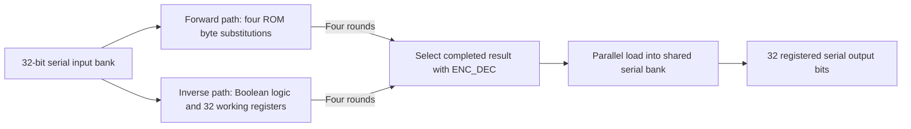

# How the original cipher works

The original recovered design is a **custom 32-bit cipher with four rounds**, using the AES byte-substitution table. Each encryption round XORs the word with one fixed 32-bit mask, substitutes each of its four bytes, then rotates the word left by one byte. Decryption reverses those operations. The same mask is reused in every round.

This is now an original-source reconstruction, beyond the earlier architectural proposal. It comes from the recovered RTL, original memory contents and documented host interface. It was checked independently against the unchanged original Verilog. No published challenge solution, shared solution chat, excluded Claude implementation or separate professor-supplied AES design supplied the algorithm.

## Exact operations

```text
F(x) = ROL32(SubBytes_AES(x XOR K), 8)
G(x) = InvSubBytes_AES(ROR32(x, 8)) XOR K
Encrypt(x) = F(F(F(F(x))))
Decrypt(x) = G(G(G(G(x))))
```

`SubBytes_AES` applies the AES S-box to each byte independently; `InvSubBytes_AES` applies its inverse. `K` is one 32-bit fixed mask, made of four fixed 8-bit parts. Bytes are numbered least-significant first. Forward output byte `(j+1) mod 4` is `S(input[j] XOR K[j])`; inverse output byte `j` is `S^-1(input[(j+1) mod 4]) XOR K[j]`.

Using an AES component does **not** make this standard AES. Standard AES has 128-bit blocks and its own round structure and key expansion. This design has 32-bit blocks, four rounds, byte rotation, no AES MixColumns and no AES key expansion. The byte table was independently calculated from the mathematics in [NIST FIPS 197, sections 4 and 5.1.1](https://nvlpubs.nist.gov/nistpubs/FIPS/NIST.FIPS.197-upd1.pdf), then compared with all original table entries after tracing the bit wiring.

## Key handling

The fixed XOR operation appears as hardwired inversions on selected data wires. Initial and feedback paths contain the same per-byte inversions, so the effective mask stays constant across all four rounds. The inverse path applies the matching mask after inverse substitution. The four memories have disabled write clocks and write-clock enables.

There is no evolving round-key state, separate runtime key port, or key-loading step in the supplied normal protocol. The initial round depends on the newly loaded message, not a previous normal transaction. These source dependencies establish fixed-mask handling rather than merely relying on the absence of a port named “key.”

This does not establish the original author's variable names, how the constant was selected, its entropy or security. The reproduction script derives the mask internally from the original wires; no numeric bonus-key result or key-exfiltration mechanism is supplied.

## Data path and clocks



1. Chip-select low shifts in 32 bits, most-significant first.
2. START with chip-select high performs the first round. Three more rising edges complete rounds two through four. The two synchronized counters follow `00 → 01 → 10 → 11 → 00`.
3. Forward and inverse paths compute concurrently. `ENC_DEC=0` selects the forward result; `ENC_DEC=1` selects the inverse. The selection acts at the parallel result load, not as a round-key or counter selector. The normal driver keeps it stable.
4. BUSY falls after round four. A **further rising edge with chip-select still high** copies the selected result into the serial bank. Reading immediately can miss this load and return old input.
5. The host waits seven clocks after START, then shifts out 32 bits. Seven wait clocks are not seven cipher rounds.

## What was verified

| Check | Result |
|---|---|
| Original ROMs against mathematical AES S-box after wiring normalization | All 256 entries in each of four memories match. |
| Exact source-derived byte identities | 4,096 checks confirm initial/feedback equality and both directions of inversion for every byte value in every slot. |
| Original control equations | 9,344 identities over 512 assignments, over the documented reset and reachable-state conditions; states outside those conditions are not covered. |
| Independent mathematical model against original Boolean/ROM interpreter | 2,564 complete transactions across 1,282 distinct words; 20,512 round-state matches and zero mismatches. |
| Untouched original Verilog and primitive simulation | Same 2,564 transactions; 20,512 round-state comparisons and 12,820 serial/BUSY checks; zero failures. |

Inputs include every byte value in each position, walking ones, extremes, the supplied pair and seeded random words. Both encryption and decryption are tested. The original example `59c359c3 → 9cd84392` and its reverse match. The raw table originally failed a direct AES comparison because its address and output bits are reordered; normalization resolves that earlier uncertainty.

Read the [reconstruction report](addenda/2026-11-12-cipher-reconstruction/README.md), [structured results](addenda/2026-11-12-cipher-reconstruction/analysis/RECONSTRUCTION_RESULTS.json), [original simulator log](addenda/2026-11-12-cipher-reconstruction/verification/icarus_run/1.stdout), and [independent Trojan-chat source audit](addenda/2026-11-12-cipher-reconstruction/trojan_review/REPORT.md). Reproduction instructions and all current Qwen prompts, replies and corrections are included there.

## Limits that remain

The operations, round count, bit/byte ordering and effective fixed-mask handling are now established for the recovered digital design under the documented protocol. The author's original algorithm name, design rationale and cryptographic strength are not established. The exact byte checks support local algebraic conclusions; the full simulator run is finite and is not a new whole-system formal proof covering arbitrary malformed frames, asynchronous behavior or hardware timing.

The [reference-board pin audit](addenda/2026-11-12-qwen-verification/pin_audit/REPORT.md) separately establishes the published board's pin map, including the physical BUSY/LED label distinction. No particular board was tested and the earlier automatically pinned bitstream is not newly validated for that board.

This closes the earlier cipher-operation/key-handling explanation gap. It does not close the separate gaps in historical AI logs, stealth, physical overhead, generation automation or instructor acceptance. Original RTL, testbenches and sealed evidence remain unchanged. Earlier addenda and the original brief are preserved as historical records; this document supersedes their statements that the cipher was still unidentified.
