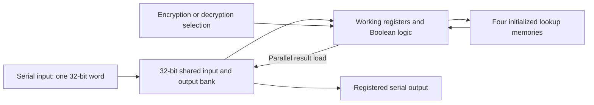

# How the recovered encryption system works: supported proposal

The recovered FPGA design accepts a **32-bit word**, processes it over several clock cycles using logic and fixed lookup storage, and shifts a 32-bit result back out. A direction input selects the specified encryption or decryption operation. This explains the observed architecture; **the exact cipher, round equations and key handling remain unidentified**.

This document describes only the unchanged recovered baseline. It uses the original interface, supplied host program, recovered RTL and saved verification records. It does not infer an algorithm from the separate AES course package, from another person's solution, or from an earlier model's unsupported AES-128 claim. The [technical explanation](addenda/2026-11-12/explanation/PROPOSED_ENCRYPTION_EXPLANATION.md) and [source index](addenda/2026-11-12/explanation/SOURCE_INDEX.md) give the detailed claims and references, labeled E01–E12 below.

## Data path in plain English

This is a functional sketch of connections, not a recovered round algorithm or a new synthesized design. [E01, E04–E07]

1. **Load the input.** With chip-select low, 32 clock edges shift the input into a shared register bank. The supplied host sends the most-significant byte and bit first. The output is also registered on the clock edge, so sampling must respect that behavior. [E02, E04]
2. **Start processing.** With chip-select high, the host selects the direction and pulses START. A separate 32-bit working bank, lookup-memory outputs and Boolean logic carry out the transformation. The mode input affects the datapath itself. Keep the mode stable as the recorded driver does. [E02, E05, E07]
3. **Use fixed lookup storage.** There are four initialized memory instances. Their write clocks and write enables resolve to zero in the recovered design. This supports describing them as lookup storage during normal operation. It does not establish that they contain AES tables, a key schedule or any particular substitution function; their initialization values were excluded from this analysis. [E06]
4. **Copy the result before reading.** BUSY falling and the serial-output bank receiving the result are separate events. Under the documented schedule, a further rising clock edge with chip-select high copies the result into that bank. Immediately beginning serial extraction can miss this copy and return the old input. [E08–E09]
5. **Read the output.** The next 32 serial clocks shift the result out through MISO while incoming bits overwrite the shared bank. This is why the documented host sequence and sampling order matter. [E02, E04]

## Why the extra clock matters

The recovered control includes a one-clock delayed BUSY register. When current BUSY is low but its delayed value is high, the shared bank is enabled to load the parallel result on the next edge. Chip-select must still be high on that edge to select the result rather than shifting serial data. This follows from the baseline's register and enable equations; it is not an added workaround in this update. [E08]

The saved evidence agrees with that explanation: immediate-first-BUSY-low reads failed in all eight recorded cases, while the supplied host's longer schedule passed its known-answer checks. The host actually emits seven clocks after the launch edge. Its comments and the observed processing-clock count must not be treated as the number of cryptographic rounds. These are historical digital-model observations, not measurements of physical SPI timing. [E09]

## What the tests tell us, and what they do not

| Evidence | Supported conclusion | Limit |
|---|---|---|
| Original supplied plaintext/ciphertext pair, tested in both directions | The recovered implementation matches that supplied expected pair under the recorded schedule. | Repeating one pair does not identify a cipher or supply thousands of independent vectors. |
| Agreement between baseline representations on additional inputs | The compared representations agree within the documented tests or proof assumptions. | Agreement is not an independent oracle for the intended cryptographic algorithm. |
| Historical equivalence reports for baseline and regenerated-bitstream RTL | Conditional digital-model correspondence, including prescribed stable-mode host transactions. | These preserve the baseline's readout limitation; they do not prove physical silicon behavior or correctness of the current modification. |
| Current package's ordinary and demonstration logs | The recorded finite checks for the current package passed, and deliberately broken controls failed. | They do not establish every possible input, universal encryption/decryption inversion, stealth or hardware cost. |

The first three rows are supported by E09–E11 and the linked historical reports. The last row is documented in the [original technical brief](README.md) and [current guide](CURRENT_GUIDE.md); it is deliberately kept separate from the baseline-equivalence evidence.

## Remaining unknowns

We have a source-supported explanation of input loading, state/storage organization, direction selection, processing controls and output timing. We have not independently established the named algorithm, interpretation of the stored values, round equations, number of cryptographic rounds, key origin/schedule or cryptographic strength. No secret key was recovered. [E12]

The original qualifier asks for a **proposed explanation** of the encryption system. This document supplies that proposal at the architecture and interface level and makes its limits explicit. It does not claim a complete mathematical reconstruction. Additional chat recovery corroborates the same limits; it supplies no missing cipher proof.

All source-backed claims here point to the existing original-materials evidence map. This update adds explanation and evidence organization; no HDL, synthesis, hardware operation or new simulation was performed.
